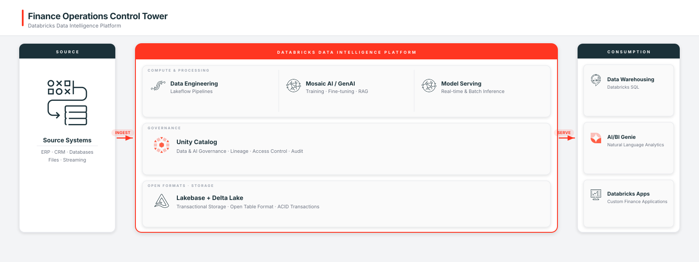

# Finance Operations Control Tower
### Implementation Guide
A reference for building this solution on the Databricks Data Intelligence Platform.
Accompanies: finance-ops-control-tower demo.

| Overview |  |
|---|---|
| What it is | An end-to-end Finance & Accounting demo on Databricks covering Procure-to-Pay, Order-to-Cash, and Record-to-Report workflows. It ingests ERP data through a medallion lakehouse pipeline, applies AI-powered invoice extraction and 3-way matching, and surfaces results in a real-time React/FastAPI app with a multi-agent conversational AI sidebar. The demo quantifies outcomes like 75–85% invoice processing cost reduction and 50–70% faster month-end close. |
| Intended audience | Teams pursuing Finance Operations Automation; AI Invoice Processing, and the data and platform teams who support them. |
| Outcome delivered | _[to draft — from `.demo-meta.yaml` / SA]_ |
| Requirements | A Databricks workspace with Unity Catalog and the platform capabilities below (Data Engineering (Lakeflow), Data Warehousing (Databricks SQL), AI/BI Genie, Mosaic AI / GenAI, Model Serving, Unity Catalog (Governance)). |
| Time to deploy | About 45–60 minutes for the demo (including data generation and pipeline build); 3–6 months to a production deployment. |
| Built with | Data Engineering (Lakeflow), Data Warehousing (Databricks SQL), AI/BI Genie, Mosaic AI / GenAI, Model Serving, Unity Catalog (Governance) |

**How to use this guide:** Section 1 makes the case and frames the problem. Architects focus on Sections 3-4. Section 5 documents each module. Section 6 covers building and deploying. Sections 7-8 cover the project plan and Professional Services effort.

## 1. Why Databricks & Business Context
**Why Databricks (the Databricks Technical Advantage):**

Finance operations data is structurally split: high-volume transactional records in ERP exports, unstructured invoice documents, and operational state that must be written back in real time. A stitched stack forces separate tools for each concern and breaks governance at every seam. The Databricks Data Intelligence Platform eliminates that fragmentation. Lakeflow pipelines ingest and enforce quality contracts from raw files through to business-ready Delta tables. Databricks SQL delivers sub-second query performance over those tables. Unity Catalog provides a single governance layer with column-level lineage and audit trails that satisfy SOX requirements without retrofitting. Mosaic AI and Model Serving power document extraction and multi-agent orchestration on the same platform. A Genie space gives finance users natural-language access to every metric. Lakebase holds operational write-back state. A Databricks App surfaces everything in a governed, OAuth-secured interface. One platform; no integration tax.

**The problem this solves:**

Finance teams running Procure-to-Pay, Order-to-Cash, and Record-to-Report on ERP systems face a structural gap: those systems are optimized for recording transactions, not for analyzing them. Invoice matching happens in spreadsheets, AR aging data arrives as weekly batch exports, and journal entry validation is a manual month-end exercise. The result is AP clerks spending the majority of their time on exception handling, collections teams working from stale data, and a close cycle that stretches to ten business days. This solution replaces that fragmented, reactive operating model with a unified lakehouse that automates matching and extraction, streams live operational data to the teams who act on it, and lets controllers and CFOs query any metric in plain English without waiting for a scheduled report.

### Current State vs. Target State

| Current State | With This Solution |
|---|---|
| Invoice matching is a manual, multi-day spreadsheet process that exposes the business to duplicate payments and fraud. | Lakeflow pipelines automate three-way matching at ingestion time, flagging exceptions and routing straight-through approvals without human touch. |
| AR aging and GL data arrive as periodic ERP extracts, leaving collections and accounting teams operating on stale information. | A Databricks App streams live operational data from Delta Gold tables, so teams act on current balances, overdue queues, and journal entry exceptions in real time. |
| Cross-functional working capital visibility requires manual assembly from multiple system exports, and AI adoption is blocked by poor data quality. | Unity Catalog enforces a governed, lineage-tracked data model across all three workflows, and a Genie space with a Multi-Agent Supervisor lets any finance user query the full dataset conversationally. |

## 2. Solution Components
The Finance Operations Control Tower combines Databricks data, AI, and application products into a unified platform covering the full Procure-to-Pay, Order-to-Cash, and Record-to-Report lifecycle.

| Capability | Purpose | Databricks products |
|---|---|---|
| Finance data ingestion and pipeline automation | Incrementally ingest ERP exports and unstructured documents through bronze, silver, and gold layers with automated 3-way matching | Lakeflow pipelines, Auto Loader, Unity Catalog |
| AI invoice processing | Extract structured fields from raw invoice documents using built-in SQL AI functions, with ERP reconciliation for straight-through processing | Lakeflow pipelines, Model Serving (built-in `ai_parse_document` / `ai_extract`) |
| Accounts payable and receivable operations | Stream live invoice exception queues and AR aging data to finance operators, with approval and collection-call actions written back to an operational store | Databricks Apps, Lakebase |
| Month-end close acceleration | Enforce data quality contracts on journal entries, quarantine unbalanced records, and surface a continuously updated trial balance with variance alerts | Lakeflow pipelines, Unity Catalog |
| Conversational analytics | Let finance users query P2P, O2C, and R2R metrics in plain English across domain-specific analytic spaces, with a supervisor routing each question to the right agent and session memory persisting multi-turn context | Genie, Agent Bricks (Multi-Agent Supervisor), Lakebase, Databricks Apps |

## 3. Reference Architecture
*(Bound reference architecture: `arch_lakebase_app` — bind @ HIGH.)*

**Figure 1 — Reference Architecture**



### 3.1 Platform Components & Layers
| Layer | Databricks Product | Role |
|---|---|---|
| Govern | Unity Catalog · Lakebase roles | Analytical governance + operational access; unified identity |
| Store — OLTP | Lakebase (Postgres) | Low-latency app state, transactional reads/writes |
| Store — analytical | Delta Lake / UC tables | Governed system of record + analytics/ML |
| Sync | Lakebase ↔ lakehouse | Keep operational + analytical copies coherent |
| Intelligence | Model Serving · Genie · SQL | Endpoints the app calls |
| Experience | Databricks Apps | Interactive UI / API |

### 3.2 Data Flow (Medallion)
| Stage | Processing | Example |
|---|---|---|
| Operational | App reads/writes to Lakebase (OLTP) | app_sessions, transactions |
| Silver/Gold | Synced into the governed lakehouse; conformed + aggregated | orders, daily_activity |
| Serving | Governed endpoints the app calls back into | scoring_endpoint, genie_room |

### 3.3 Governance
All data and AI assets are governed through Unity Catalog (access, masking/row-level security, lineage).

### 3.4 Operational Components
The non-table Databricks products this solution provisions alongside the data:

| Databricks Product | Role |
|---|---|
| genie_space | Natural-language analytics over the solution's gold tables |
| mas_supervisor | Orchestrates the solution's multi-agent workflow |

## 4. Data Foundation & Data Readiness
### 4.1 Source Systems
| Source | Data Provided | Ingestion Method | Refresh |
|---|---|---|---|
| Synthetic ERP data generator (demo only) | Vendor master, customer master, purchase orders, AP invoices, goods receipt notes, sales orders, payment records, journal entries | Notebook-based data generation script writes synthetic records directly to Delta tables in the Bronze layer; loaded once as part of the setup job | On-demand (re-run setup job to regenerate) |
| Synthetic invoice documents (demo only) | Unstructured text invoice files representing PDF/email invoice content, used as input to AI extraction | Generation script writes text files to a Unity Catalog Volume; Auto Loader ingests them into the Bronze raw documents table | On-demand (re-run setup job to regenerate) |

> **Note:** This demo uses entirely synthetic data. In a production deployment, the Bronze layer would receive incremental ERP exports (SAP, Oracle, NetSuite, or equivalent) via Auto Loader or Lakeflow pipelines, with refresh cadence matching the source system's export schedule (typically continuous or daily).

### 4.2 Table Reference
Tables use `{{catalog}}.{{schema}}` placeholder notation (substitute your own catalog and schema). The gold/serving tables below are the solution's serving contract.

| Table | Layer | Key Columns | Purpose |
|---|---|---|---|

### 4.4 Data Readiness
What must be true of your data to build this for real.

| Readiness check | What's needed | Notes |
|---|---|---|
| Availability | The source feeds in §4.1 connected for your scope | Demo/public feeds become your production connectors |
| Quality | Clean entity identifiers, point-in-time correctness, stable schemas | Becomes data-quality expectations on the Silver layer |
| History | Enough history to train/backtest and to populate the gold serving tables | Backfill Bronze/Silver before model training |
| Governance | Access roles and masking for sensitive data | Applied in Unity Catalog (see §3.3) |
| Mapping | Map your source schemas to the §4.2 target tables | The key integration step (see §6.2) |


## 5. Modules in Detail
### Module 1 — Data Ingestion and Medallion Pipeline

**Purpose:** Continuously ingest raw finance data from ERP sources and transform it through Bronze, Silver, and Gold layers with enforced quality contracts. **Primary persona:** Data/Analytics Engineer.

**Functionality:** Lakeflow pipelines (Delta Live Tables) handle incremental ingestion via Auto Loader, apply DLT Expectations to quarantine or drop invalid records at each layer, and execute automated three-way PO-Invoice-GRN matching in the Silver transformation so that only clean, reconciled data reaches Gold reporting tables.

**Databricks products:** Lakeflow (Delta Live Tables), Auto Loader, Delta Lake, Unity Catalog

---

### Module 2 — AI Invoice Processing

**Purpose:** Extract structured fields from unstructured invoice documents using built-in SQL AI functions, eliminating manual data entry and enabling straight-through payment processing. **Primary persona:** Accounts Payable Analyst.

**Functionality:** A notebook-based processing stage calls `ai_parse_document()` to perform OCR and text extraction on raw invoice files, then `ai_extract()` to pull structured fields (vendor identifiers, line items, tax components, payment details) into a Silver table; extracted amounts are reconciled against ERP-sourced values within a configurable tolerance to determine eligibility for touchless approval.

**Databricks products:** Lakeflow (Delta Live Tables), `ai_parse_document()` and `ai_extract()` built-in SQL functions, Unity Catalog Volumes, Delta Lake

---

### Module 3 — Accounts Payable Operations

**Purpose:** Give AP teams a real-time invoice queue with exception triage, AI-extracted field comparison, and auditable approval workflows. **Primary persona:** Accounts Payable Clerk / AP Manager.

**Functionality:** The operations app streams invoice records live from Gold tables, surfaces each invoice's match status (fully matched, amount mismatch, no PO reference), and lets the reviewer approve or reject exceptions with a reason code; decisions are written to a persistent operational store so the audit trail is maintained outside the analytical lakehouse.

**Databricks products:** Databricks Apps, Lakeflow (Delta Live Tables) Gold tables, Lakebase (managed Postgres for operational state), Delta Lake

---

### Module 4 — Accounts Receivable Operations

**Purpose:** Provide collections teams with a continuously refreshed AR aging queue and a structured call-logging workflow to reduce days sales outstanding. **Primary persona:** Collections Analyst / AR Manager.

**Functionality:** The operations app streams overdue customer records ranked by aging bucket and outstanding balance, and collectors log call outcomes (promise-to-pay dates, disputes, escalations) directly in the interface; all call records are persisted to the operational database for downstream reporting and manager review.

**Databricks products:** Databricks Apps, Lakeflow Gold tables, Lakebase (managed Postgres for operational state), Delta Lake

---

### Module 5 — Month-End Close Acceleration

**Purpose:** Replace manual journal-entry validation and trial-balance assembly with a continuously updated GL operations view that surfaces reconciliation issues as they occur. **Primary persona:** Controller / GL Accountant.

**Functionality:** The GL tab of the operations app streams journal-entry validation results in real time, highlights unbalanced entries quarantined by DLT Expectations, and presents a live trial balance with period-over-period variance flags alongside a close checklist so the team can track close progress without waiting for batch ERP extracts.

**Databricks products:** Databricks Apps, Lakeflow (Delta Live Tables with quarantine Expectations), Lakeflow Gold tables, Delta Lake

---

### Module 6 — Conversational Analytics (Multi-Agent AI Chat)

**Purpose:** Let finance users query P2P, O2C, and R2R data in plain English through a multi-agent system that routes each question to the appropriate domain analyst and maintains conversational context across turns. **Primary persona:** CFO / Controller / Finance Business Partner.

**Functionality:** A Multi-Agent Supervisor (Claude via Foundation Model API in forced tool-use mode) classifies each user question and delegates it to the relevant domain sub-agent, each backed by a Genie space over the corresponding Gold tables; session memory is persisted to Lakebase so multi-turn references resolve correctly, and users can resume past sessions from a history drawer in the app.

**Databricks products:** Mosaic AI Agent Framework (Multi-Agent Supervisor), Genie (domain-specific spaces for P2P, O2C, and R2R analytics), Foundation Model API (Claude), Lakebase (managed Postgres for session memory), Databricks Apps

---

### Module 7 — Unified Finance KPI Dashboard

**Purpose:** Surface a single working-capital view across Procure-to-Pay, Order-to-Cash, and Record-to-Report so finance leadership can assess operational health without switching between systems. **Primary persona:** CFO / Finance Director.

**Functionality:** The operations app header aggregates live KPIs (invoice volumes and match rates, overdue AR balances, payment run totals, close status) queried directly from Gold Delta tables via a serverless SQL warehouse, giving leadership a continuously current snapshot rather than a scheduled report.

**Databricks products:** Databricks Apps, Delta Lake Gold tables, Databricks SQL (serverless warehouse), Unity Catalog

---

### Module 8 — Data Quality and Governance

**Purpose:** Enforce explicit data quality contracts at every pipeline layer and provide full column-level lineage from source file to Gold table to support SOX audit requirements. **Primary persona:** Data Engineer / Finance Compliance Officer.

**Functionality:** DLT Expectations define named quality rules at Bronze and Silver layers, routing failing records to quarantine tables rather than silently dropping them, while Unity Catalog captures end-to-end lineage, AI-generated table and column descriptions, and role-based access controls so any Gold query result is traceable back to its source document.

**Databricks products:** Lakeflow (Delta Live Tables Expectations and quarantine pattern), Unity Catalog (lineage, RBAC, audit trail), Delta Lake

## 6. Build & Deploy
### 6.1 Deploy the demo
**Prerequisites:** Databricks CLI installed and authenticated (profile or `DATABRICKS_HOST` + `DATABRICKS_TOKEN` environment variables). A Unity Catalog-enabled workspace with serverless compute available. An existing SQL warehouse (serverless recommended). Workspace must support Databricks Apps, Lakebase (managed Postgres), and the Foundation Model API (for Claude via FMAPI). The Genie space and Multi-Agent Supervisor endpoint must be provisioned manually before the app can serve conversational analytics (see the note below).

**Compute:** Serverless — the DLT pipeline, SQL warehouse, and Databricks App all run on serverless compute. No pinned Databricks Runtime is required.

```bash
# 1. Authenticate — choose one method
export DATABRICKS_HOST=https://<your-workspace>.cloud.databricks.com
export DATABRICKS_TOKEN=<your-pat>
# or rely on a configured CLI profile and pass --profile <your-cli-profile> to each command

# 2. Validate the Asset Bundle
databricks bundle validate -t dev

# 3. Deploy and build the full demo from zero
#    (idempotent — safe to re-run; provisions the DLT pipeline, setup/teardown jobs,
#    and the Databricks App, then runs data generation → DLT → Gold → AI processing)
./setup/setup.sh --var="warehouse_id=<your-warehouse-id>"

# 4. Optional: override additional bundle variables if your environment differs
#    (catalog, schema, and Lakebase instance name can all be set the same way)
./setup/setup.sh \
  --var="warehouse_id=<your-warehouse-id>" \
  --var="lakebase_instance_name=<your-lakebase-instance-name>"

# 5. Provision the Lakebase instance (manual — no bundle resource type)
databricks database create-database-instance \
  --json '{"name": "<your-lakebase-instance-name>", "capacity": "CU_1"}'
#    Then create the app database inside the instance.
#    PGHOST / PGUSER / PGPASSWORD are injected into the app automatically
#    via the attached database resource in resources/apps.yml.
#    If the instance is absent the app runs in in-memory demo mode.

# 6. Provision the Genie space (manual — no bundle resource type)
#    Run the three Genie setup notebooks in order, passing catalog, schema,
#    and warehouse_id as widget/job parameters:
#      - Table-descriptions-and-sample-questions notebook
#      - Space-creation notebook (creates the space via the SDK)
#      - Space-configuration notebook (adds instructions and curated questions;
#        requires the space_id returned by the previous notebook)
#    Then set the resulting space ID as an app environment variable:
#      GENIE_SPACE_ID=<your-genie-space-id>   # in app/app.yaml or app settings

# 7. Provision the Multi-Agent Supervisor endpoint (manual — not DAB-deployable)
#    Create the supervisor in AgentBricks (UI), attach the Genie space as a tool,
#    then set the endpoint name as an app environment variable:
#      MAS_ENDPOINT_NAME=<your-mas-endpoint-name>   # in app/app.yaml or app settings

# 8. To tear everything down (drops the catalog, then destroys bundle resources)
./setup/teardown.sh
```

**Validation:** After `setup.sh` completes, open the Databricks App URL from the workspace Apps UI. Confirm that the header KPI cards render (total invoices, exceptions count, overdue AR value). Click **Start** on the AP Operations tab and verify that invoice records stream in via SSE with match-status badges. Submit a test approval and confirm it is written to the Lakebase operational tables. Open the AI chat panel, ask a finance question, and verify that the routing badge shows the supervisor dispatching to the correct domain agent and that a response with a SQL accordion is returned. In the workspace, confirm the DLT pipeline shows a completed update and that Gold-layer tables are queryable from the SQL warehouse.

**Note — components not deployable via Asset Bundle:** The following must be provisioned manually and their IDs wired back to the app before conversational AI features are available: the Lakebase managed Postgres instance, the Genie space (created via the three Genie setup notebooks), and the Multi-Agent Supervisor (AgentBricks) serving endpoint. Detailed steps for each are in `MANUAL_DEPLOY.md`.

### 6.2 Build it in your environment (yourself or with a partner)
Connect production data via Lakeflow Connect into the same target tables, apply your governance (RLS/masking), operationalize (CI/CD, observability), and tune for your domain. Production guidance per the Well-Architected Framework: - **Performance Efficiency** — Postgres-native OLTP for the app; lakehouse for analytics/ML.
- **Governance** — one governed analytical system of record behind the operational tier.
- **Reliability** — managed Postgres + coherent sync instead of a bolted-on external DB.
- **Production gap-fill (for IGs):** real auth/SSO, connection pooling + scaling, sync SLAs and
  conflict handling, backup/DR for the operational tier.

## 7. Project Plan & Timeline
| Phase | Activities | Outcome | Indicative duration |
|---|---|---|---|
| Foundation | Workspace + UC + access; deploy the demo | Running reference | 1-2 weeks |
| Data integration | Connect sources; map to the target tables; data quality | Production data flowing | 2-4 weeks |
| Hardening | Governance, CI/CD, observability, tuning | Production-ready | 2-3 weeks |
| Go-live | UAT, validation, cutover | Live | 1-2 weeks |

## 8. Professional Services Sizing
| Scenario | Scope | Indicative PS effort |
|---|---|---|
| Small | Supported sources, light governance, single environment | S |
| Medium | Some custom ingestion, multi-environment, standard governance | M |
| Large | Complex/custom integration, strict compliance, multi-region | L |

## 9. Resources & Next Steps
| Resource | Location |
|---|---|
| Source code | demo repository |
| Product documentation | docs.databricks.com |
| Guided build | Engage your Databricks Solutions Architect or a partner |

*Prepared by Databricks Field Engineering. Generated from the demo's `.demo-meta.yaml` + Unity Catalog schema.*
